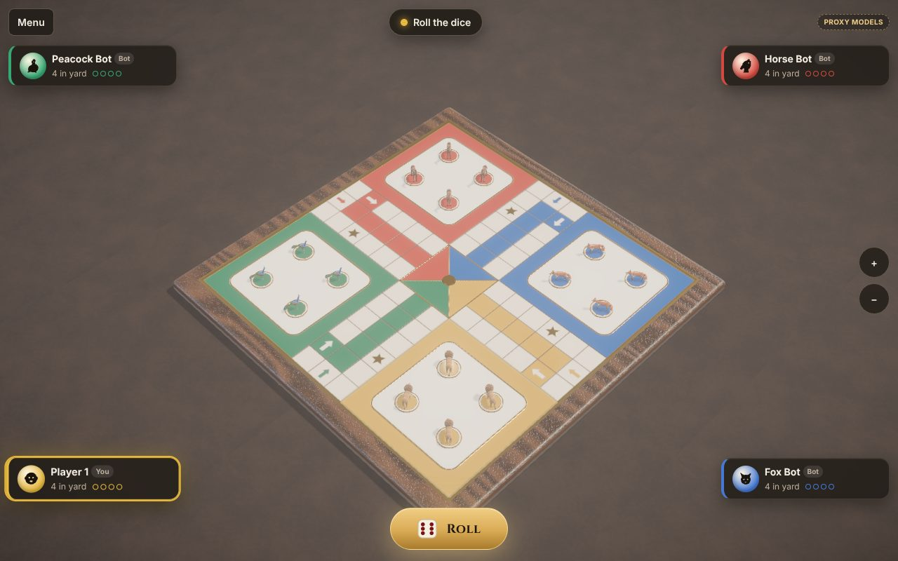
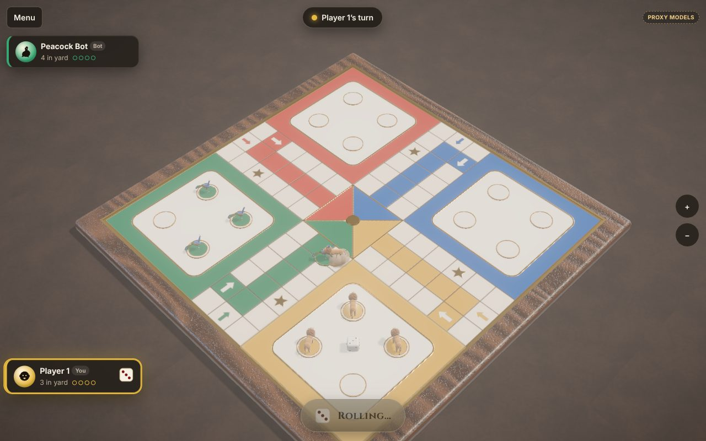
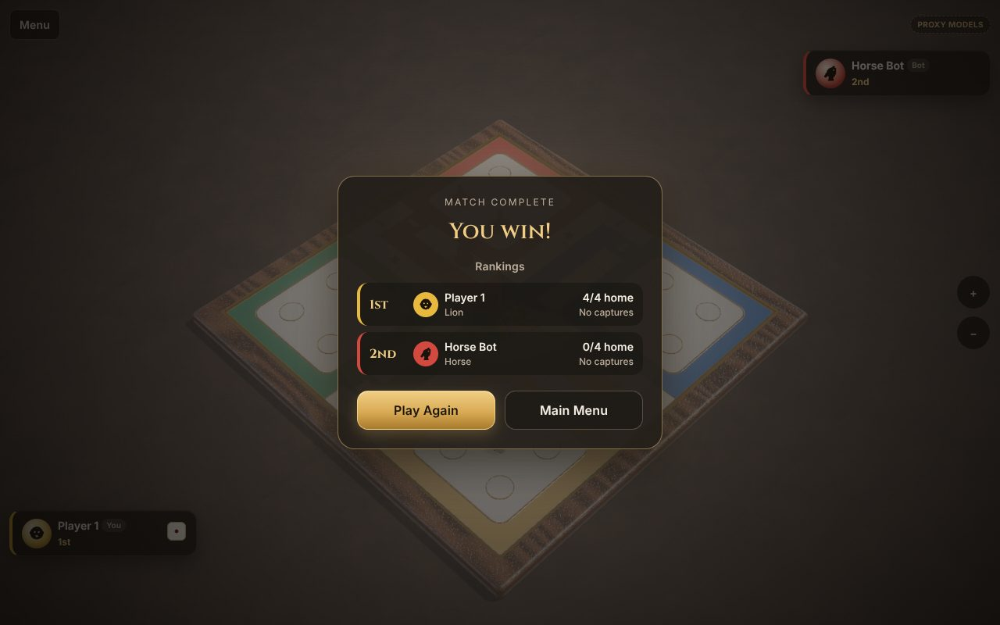
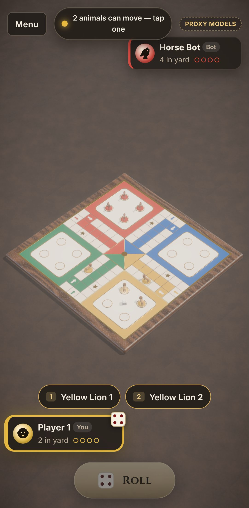

# Progress

Status of the build against the product brief, what has been verified and how,
what is known to be missing, and what to do next. Update this file whenever
status changes — an item is **done** only when it is implemented **and**
verified by an automated test or an inspected browser run.

_Last updated: 2026-11-04._

## 1. Milestones

| Milestone | Scope                                                                                        | Status                                                                                                                       |
| --------- | -------------------------------------------------------------------------------------------- | ---------------------------------------------------------------------------------------------------------------------------- |
| M0        | Monorepo, dependency verification, project docs                                              | Done                                                                                                                         |
| M1        | Rules engine; playable 3D slice (menu, board, dice, animals, local + bots, victory, restart) | Done                                                                                                                         |
| M2        | GLB pipeline, animation controllers, 12 capture encounters, audio                            | Done with **proxy art** — realistic final models need external art (P7)                                                      |
| M3        | Colyseus authoritative multiplayer: rooms, codes, quick match, reconnection                  | Done                                                                                                                         |
| M4        | Firebase auth/Firestore, three languages, settings, analytics/ads abstractions               | Done; Google sign-in UI not yet exercised against a real Firebase project (see §5)                                           |
| M5        | Tests, security hardening, performance probes, deployment config, docs                       | Done for this repository; real-device performance, cross-browser runs and a deployed staging environment are next steps (§6) |

## 2. Requirement status (IDs from PRD.md)

| ID  | Requirement                                                               | Status                            | Evidence                                                                                                                                                    |
| --- | ------------------------------------------------------------------------- | --------------------------------- | ----------------------------------------------------------------------------------------------------------------------------------------------------------- |
| F1  | Classic engine, configurable `RuleSet`                                    | Done                              | 116 engine tests incl. 360 simulated matches and 300 fast-check command streams; GAME_RULES.md                                                              |
| F2  | 2/3/4 players, documented seats                                           | Done                              | Engine tests; server seat tests; GAME_RULES.md §1.2–1.3                                                                                                     |
| F3  | Legal-move highlighting; tap/click/keyboard selection                     | Done                              | Browser tests: full human match via clicks; keyboard test (R rolls, 1–4 chooses)                                                                            |
| F4  | Bonus rolls, three sixes, captures, safe squares, blockades, exact finish | Done                              | Engine tests per rule; capture scenario browser test                                                                                                        |
| F5  | Rankings, results, play again                                             | Done                              | Victory scenario browser test (results → play again); full-match tests                                                                                      |
| F6  | Bots, three difficulties                                                  | Done                              | Bot tests; complete bot match in the browser                                                                                                                |
| P1  | 3D tabletop board aligned with the engine                                 | Done                              | Procedural board from the shared layout; screenshots                                                                                                        |
| P2  | Fixed 3/4 camera, limited zoom                                            | Done                              | Camera unit tests (elevation band, board fits portrait/landscape/desktop)                                                                                   |
| P3  | Four animals × four pieces, 10 animation states                           | Done (proxy art)                  | 14 clips per species; GLB test checks every clip and binding                                                                                                |
| P4  | Twelve directed capture interactions, 0.8–1.4 s                           | Done (proxy art)                  | Encounter unit tests; capture screenshots                                                                                                                   |
| P5  | 3D dice, result decided before animation                                  | Done                              | Dice animate engine/server results only                                                                                                                     |
| P6  | Quality profiles, reduced motion                                          | Done                              | Low/Medium/High in the perf report; High adds post-processing; reduced-motion setting disables shake and shortens motion (not covered by an automated test) |
| P7  | Realistic final animal assets                                             | **Not done — needs external art** | ASSET_MANIFEST.md has the production spec and swap procedure                                                                                                |
| O1  | Authoritative rooms: server dice, validation, idempotency                 | Done                              | Server tests: dice authority, out-of-turn/duplicate/stale/malformed rejection                                                                               |
| O2  | Quick match by size; private rooms, codes, invite links                   | Done                              | Server quick-match test; browser private-room and quick-match tests                                                                                         |
| O3  | Lobby: seats, names, colours, animals, ready, host start                  | Done                              | Private-room browser test                                                                                                                                   |
| O4  | Reconnection, refresh, duplicate connections, abandonment, turn timers    | Done                              | Server tests for each; browser reload/reconnect                                                                                                             |
| O5  | Match summaries persisted                                                 | Done                              | Emulator test: summaries stored, statistics incremented                                                                                                     |
| U1  | Menu, settings, how-to-play, profile                                      | Done                              | Menu browser tests                                                                                                                                          |
| U2  | English, Hindi, Simplified Chinese, persisted                             | Done                              | i18n parity tests; language browser test                                                                                                                    |
| U3  | Audio with independent volumes and mute                                   | Done (procedural sounds)          | Settings persistence test; sounds are synthesised and have not had a listening review                                                                       |
| U4  | Firebase guest + Google sign-in; server token verification                | Partly verified                   | Server verification and rules on emulators; client sign-in UI needs a real project to test                                                                  |
| U5  | Analytics and ads abstractions, consent-gated, never during play          | Done                              | Analytics/ads unit tests; no SDKs bundled                                                                                                                   |
| U6  | Phone portrait/landscape and desktop layouts                              | Done                              | Pixel 7 browser project and screenshots; see the portrait note in §5                                                                                        |

## 3. Verification log (2026-11-04)

| Suite                                   | Result                                                                                                                                                                                                                                                                                                                                 |
| --------------------------------------- | -------------------------------------------------------------------------------------------------------------------------------------------------------------------------------------------------------------------------------------------------------------------------------------------------------------------------------------- |
| `pnpm typecheck`                        | Clean in all three packages                                                                                                                                                                                                                                                                                                            |
| `pnpm test`                             | 175 passed, 7 skipped (the emulator-only Firebase tests)                                                                                                                                                                                                                                                                               |
| `pnpm test:firebase`                    | 21 passed (5 rules, 2 Firebase server, 14 room tests) on the Auth + Firestore emulators                                                                                                                                                                                                                                                |
| `pnpm test:e2e` (default suite)         | 15 tests (13 desktop, 2 Pixel 7) on the production test build: 14 passed in the main run, including a complete bot match (5.7 min) and a complete human match through the UI (6.6 min); the keyboard test failed there (it waited for a random choice) and passed after the rewrite onto a deterministic scenario (final-build re-run) |
| `test:e2e:slow`                         | Two browsers played a complete online match through the real server and finished with identical state (11.6 min)                                                                                                                                                                                                                       |
| `test:e2e:screenshots`, `test:e2e:perf` | 16 passed; regenerated `docs/screenshots` (JPEG) and `docs/perf` (desktop 1280×800 and Pixel 7)                                                                                                                                                                                                                                        |
| Final-build re-run                      | After the last changes (matchmaking guard, choice scenario, phone chip placement): keyboard test, private room, quick match, the complete online match and both choice screenshots — 6/6 passed                                                                                                                                        |
| Game server production bundle           | `node dist/index.js` (esbuild, ~61 kB) boots with `NODE_ENV=production`, serves `/api/health` and `/api/guest`, and refuses anonymous matchmaking (525); earlier also run on a `pnpm deploy --prod` tree                                                                                                                               |
| Docker image                            | **Not built here** (no Docker in this environment); the Dockerfile's build steps were run individually                                                                                                                                                                                                                                 |

## 4. Performance

Measured by `e2e/performance.spec.ts` in headless Chromium with **SwiftShader
(CPU) WebGL**. Frame rates here are a pessimistic floor, not device numbers;
draw calls, triangles, load times and memory are representative.

Menu (first load, production test build):

| Project | TTFB  | DOMContentLoaded | First contentful paint | Transferred |
| ------- | ----- | ---------------- | ---------------------- | ----------- |
| desktop | 19 ms | 60 ms            | 140 ms                 | 577 KB      |
| mobile  | 9 ms  | 90 ms            | 112 ms                 | 578 KB      |

Game scene, four players (bots), 6 s after the scene is ready:

| Project | Quality | Scene ready | FPS (SwiftShader) | Draw calls | Triangles | Textures | Programs | DPR  | JS heap | Animal load, ms (lion/peacock/horse/fox) |
| ------- | ------- | ----------- | ----------------- | ---------- | --------- | -------- | -------- | ---- | ------- | ---------------------------------------- |
| desktop | low     | 6.6 s       | 3.6               | 95         | 167,202   | 51       | 14       | 1    | 22 MB   | 51/60/62/2633 (glb)                      |
| desktop | medium  | 9.3 s       | 1.5               | 153        | 308,698   | 53       | 22       | 1    | 22 MB   | 18/33/35/24 (glb)                        |
| desktop | high    | 13.1 s      | 1.4               | 172        | 308,717   | 77       | 41       | 1    | 22 MB   | 46/56/61/20 (glb)                        |
| mobile  | low     | 5.2 s       | 3.2               | 95         | 167,202   | 51       | 14       | 1.25 | 22 MB   | 57/72/971/80 (glb)                       |
| mobile  | medium  | 3.2 s       | 10.7              | 153        | 308,698   | 53       | 22       | 1.75 | 22 MB   | 21/23/28/31 (glb)                        |
| mobile  | high    | 14.3 s      | 1.2               | 172        | 308,717   | 77       | 41       | 2    | 22 MB   | 22/28/32/37 (glb)                        |

SwiftShader frame rates are noisy (they depend on what is animating during the
sample) and say nothing about GPU devices; the DPR column shows each profile's
pixel-ratio cap on the Pixel 7 profile (device ratio 2.625).

- The scene is ~167k triangles (Low); the shadow-map pass on Medium/High adds
  ~140k more. Final animals within the asset spec (≤ 25k
  triangles each, 16 on the board) would raise this considerably; plan LODs or
  a lower budget for phones when the art arrives.
- Animal GLBs: 124–158 KiB each. After the first load (which includes the
  Meshopt decoder start-up and competes with shader compilation, hence the
  occasional 1–2.6 s outlier), each species loads and instances in 20–80 ms.
- The game scene is code-split from the menu; High's post-processing is a
  separate lazily loaded chunk.

### Screenshots (High quality, development proxy animals)

| Desktop match                           | Capture (Lion → Peacock)                      | Victory                                     | Phone: choosing an animal                     |
| --------------------------------------- | --------------------------------------------- | ------------------------------------------- | --------------------------------------------- |
|  |  |  |  |

All views (menus in three languages, lobby, capture sequence, phone layouts)
are in [`docs/screenshots`](screenshots).

## 5. Known limitations and risks

1. **Animals are development proxies, not realistic characters** (P7). They
   have real skeletons, skinning, PBR materials and 14 clips, and are labelled
   "Proxy models" in the HUD and menu. Realistic rigged models must be
   commissioned or licensed (ASSET_MANIFEST.md lists the spec, clip names and
   swap procedure).
2. **Small animals on screen.** The camera keeps the whole board visible (P2),
   so on a 1280×800 desktop an animal is about 30 px tall and smaller on
   portrait phones. A brief encounter close-up would make captures read better
   but needs a product decision because the brief fixes the camera.
3. **Portrait phones** show the board at roughly the screen width; zoom helps.
4. **Firebase client flows untested in a browser**: no Firebase project is
   configured here. Rules, ID-token verification and server persistence are
   tested on emulators; Google sign-in, account linking and the profile screen
   with live data still need a run against a real project.
5. **No account deletion or data export** flow yet; required before launching
   accounts in jurisdictions that mandate it (clients cannot delete profiles
   by rule; a server endpoint is needed).
6. **Chromium only.** WebKit (Safari/iOS) and Firefox have not been run.
7. **Performance not measured on real devices** (see §4).
8. **Single game-server instance.** Scaling out needs Redis presence/driver
   and sticky sessions (DEPLOYMENT.md).
9. **Abuse limits**: matchmaking needs a verified identity before any room
   lookup and is rate-limited per identity (D-22); game messages are
   rate-limited per client; guest tokens per IP. Still missing: per-IP
   connection limits (configure at the proxy/load balancer) and a host
   "remove player" control for private lobbies.
10. **Guest token in localStorage**: an XSS bug would expose it. Tokens are
    signed, scoped to guest play and expire; the CSP and React escaping reduce
    the risk.
11. **Audio is synthesised** (original and licence-free) rather than recorded;
    replace sound ids with recordings for a premium feel.
12. **No screen-space ambient occlusion** on High: n8ao 2.0.1 is incompatible
    with three r187 (DECISIONS D-19).
13. Console warnings in development: `THREE.Clock` deprecation comes from
    React Three Fiber 9.8.2 itself; Chromium warns about the AudioContext
    created before the first gesture on auto-started test matches.
14. No analytics or ad provider is integrated (by design); a privacy policy
    must be published before enabling any.

## 6. Next steps (in priority order)

1. Commission or licence the four realistic rigged animals to the
   ASSET_MANIFEST spec; drop them in through the manifest and re-run the GLB
   test, `/dev/animals` review and the browser suite.
2. Create the Firebase project (Firestore in `asia-south1`), deploy rules and
   indexes, set the `NEXT_PUBLIC_FIREBASE_*` and server variables in a staging
   environment, and verify Google sign-in, linking and profile history in a
   browser. Add an account-deletion endpoint.
3. Real-device performance pass (mid-range Android, an iPhone, a laptop with
   integrated graphics); tune quality auto-detection and shadow settings.
4. Add WebKit and Firefox Playwright projects; fix any differences.
5. Build and scan the game-server image; deploy web + server to a staging host
   **after the owner approves any paid resources** (DEPLOYMENT.md).
6. Load-test the game server; set per-IP connection limits at the proxy; add
   a host "remove player" control to private lobbies.
7. Decide on an encounter close-up camera (limitation 2).
8. Recorded audio and music; listening review of all sound ids.
9. Choose an analytics provider and publish a privacy policy before enabling it.

## 7. Resuming work

```bash
pnpm install && pnpm typecheck && pnpm test
```

```bash
pnpm test:e2e
```

Read `CLAUDE.md` for conventions. The screenshots in `docs/screenshots` are
regenerated by `pnpm --filter @ludo3d/web test:e2e:screenshots`.
